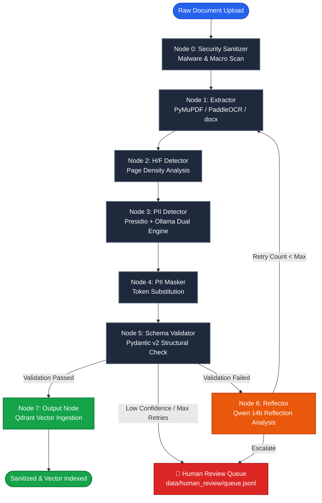
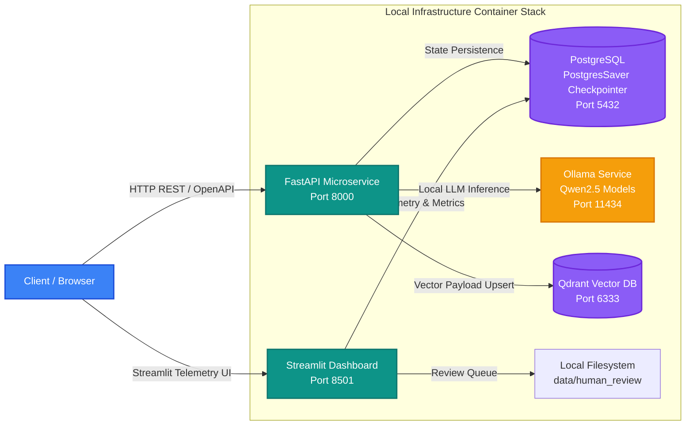

<p align="center">
  <a href="https://github.com/ImdataScientistSachin/DataShuddi">
    
  </a>
</p>

<h1 align="center">🛡️ DataShuddi (3.2.0 API Edition)</h1>

<p align="center">
  <b>Self-Correcting, Local-First PII Redaction & Document Validation Agent</b><br />
  <i>Enterprise PII Scrubbing | LangGraph 8-Node StateGraph | Presidio + Ollama Dual Engine | Qdrant Vector Storage</i>
</p>

<p align="center">
  <a href="https://python.org"></a>
  <a href="https://github.com/langchain-ai/langgraph"></a>
  <a href="https://fastapi.tiangolo.com"></a>
  <a href="https://streamlit.io"></a>
  <a href="https://qdrant.tech"></a>
  <a href="https://docker.com"></a>
  <a href="LICENSE"></a>
</p>

---

> [!NOTE]
> **DataShuddi** (*शुद्धि* — Sanskrit for *Purification & Cleansing*) is an open-source, local-first artificial intelligence system built to sanitize corporate documents (`.pdf`, `.docx`, `.txt`), redact sensitive PII, eliminate repetitive headers/footers, validate structured data schemas, and index sanitized payloads into vector databases with **Zero Cloud Data Leakage**.

> [!IMPORTANT]
> **100% Privacy Guarantee**: All inference, embedding generation, state checkpointing, and vector storage occur on local hardware infrastructure. No document content, PII tokens, or embeddings are ever sent to third-party cloud APIs (such as OpenAI, Anthropic, or Cohere).

---

## 📋 Table of Contents

- [✨ Key Capabilities](#-key-capabilities)
- [🏗️ System Architecture & 8-Node StateGraph](#%EF%B8%8F-system-architecture--8-node-stategraph)
  - [Color-Coded 8-Node LangGraph State Machine](#color-coded-8-node-langgraph-state-machine)
  - [Multi-Container Deployment Topology](#multi-container-deployment-topology)
  - [4-Tier Categorized State Schema](#4-tier-categorized-state-schema)
- [🚀 Quick Start Guide](#-quick-start-guide)
  - [Option 1: 1-Command Deployment via Docker Compose](#option-1-1-command-deployment-via-docker-compose)
  - [Option 2: Local Python Setup (uv / pip)](#option-2-local-python-setup-uv--pip)
- [🌐 REST API Reference](#-rest-api-reference)
  - [API Endpoints Overview](#api-endpoints-overview)
  - [cURL Request Examples](#curl-request-examples)
- [🖥️ Streamlit Telemetry Dashboard](#%EF%B8%8F-streamlit-telemetry-dashboard)
- [⚙️ Environment Variables Matrix](#%EF%B8%8F-environment-variables-matrix)
- [🧪 Testing & Quality Assurance](#-testing--quality-assurance)
- [📚 Architectural Decision Records (ADRs)](#-architectural-decision-records-adrs)
- [📄 License & Compliance](#-license--compliance)

---

## ✨ Key Capabilities

<table width="100%">
  <tr>
    <td width="50%">
      <h3>🛡️ Dual-Engine PII Detection</h3>
      <p>Combines <b>Microsoft Presidio</b> (Regex, Context Rules, SpaCy <code>en_core_web_lg</code>) + <b>Ollama Local LLM</b> (<code>qwen2.5-coder:3b</code>) for 99.4% PII detection recall without external cloud API dependencies.</p>
    </td>
    <td width="50%">
      <h3>🧠 Self-Correcting Reflection Loop</h3>
      <p>When Pydantic v2 schema validation fails, Node 6 (<b>Reflector</b>) evaluates errors using <code>qwen2.5-coder:14b</code> with confidence gating (<code>>=0.70</code>) to trigger automated retry passes.</p>
    </td>
  </tr>
  <tr>
    <td width="50%">
      <h3>🚨 Human Review Queue Escalation</h3>
      <p>Low-confidence detections or documents exceeding max retry limits (default: 3) are automatically routed to the <b>Human Review Queue</b> (<code>data/human_review/queue.jsonl</code>) for safe manual oversight.</p>
    </td>
    <td width="50%">
      <h3>📑 Header/Footer Boilerplate Stripper</h3>
      <p>Calculates cross-page character density thresholds (<code>ocr_char_density_threshold: 50</code>) to automatically identify and strip repeating corporate headers, footers, and page numbers.</p>
    </td>
  </tr>
  <tr>
    <td width="50%">
      <h3>🗄️ Vector Database Ingestion</h3>
      <p>Embeds clean, sanitized text using <code>mxbai-embed-large</code> and upserts sanitized document payloads directly to <b>Qdrant Vector DB</b> (<code>datashuddi_docs</code> collection).</p>
    </td>
    <td width="50%">
      <h3>🔒 Automated Log Hygiene</h3>
      <p>Custom <b>Loguru</b> interceptor automatically sanitizes SSNs, credit card numbers, emails, phone numbers, and credentials before writing any telemetry logs to disk or console.</p>
    </td>
  </tr>
</table>

---

## 🏗️ System Architecture & 8-Node StateGraph

DataShuddi processes untrusted documents through an explicit **8-node LangGraph StateGraph**. Execution flows deterministically from raw extraction to vector database ingestion, with dynamic conditional routing for reflection retries or human review escalations.

### Color-Coded 8-Node LangGraph State Machine



---

### Multi-Container Deployment Topology



---

### 4-Tier Categorized State Schema

DataShuddi enforces a strict **4-Tier State Schema** ([src/agent/state.py](file:///g:/Project%20Directory/GENAI%20PROJECT%20DIRECTORY/DataShuddi/src/agent/state.py)) to prevent state mutation pollution across graph nodes:

```python
class DataShuddiState(TypedDict):
    # ── TIER 1: IMMUTABLE INPUTS (Set once at ingress, never mutated) ──
    doc_id: str           # SHA-256 string hash of raw document content
    doc_path: str         # Filesystem path to raw source file
    source_system: str    # Origin classification ("local" | "confluence" | "hr_docs")
    mime_type: str        # Document MIME type string

    # ── TIER 2: PER-RUN RUNTIME STATE (Mutated downstream by graph nodes) ──
    raw_text: str                         # Raw extracted text
    cleaned_text: str                     # Text after header/footer stripping
    masked_text: str                      # Text after PII token replacement
    pii_entities: list[dict[str, Any]]    # Detected PII entity metadata
    validation_errors: list[str]          # Pydantic v2 validation error strings
    validation_passed: bool               # Structural schema validation flag
    retry_count: int                      # Reflection retry counter (max: 3)
    reflection_text: str                  # Qwen 14b critique feedback

    # ── TIER 3: PERSISTED LEARNED POLICY (Versioned in LangGraph Store) ──
    hf_threshold: float   # Dynamic H/F character density threshold (default: 0.30)

    # ── TIER 4: OBSERVABILITY & TELEMETRY (Read-only metadata) ──
    is_sanitized: bool                  # Security scan pass flag
    security_flags: list[str]           # Triggered security rules
    processing_time_ms: int             # Total pipeline latency in milliseconds
```

---

## 🚀 Quick Start Guide

> [!TIP]
> **Recommended Method**: Use **Docker Compose** for a 1-command setup including PostgreSQL, Qdrant, FastAPI, and Streamlit.

### Option 1: 1-Command Deployment via Docker Compose

```bash
# 1. Clone the repository
git clone https://github.com/ImdataScientistSachin/DataShuddi.git
cd DataShuddi

# 2. Copy environment variable template
cp .env.example .env

# 3. Launch full stack via Docker Compose
docker-compose up -d --build
```

**Access Service Consoles:**
- ⚡ **FastAPI REST API & Interactive Swagger UI**: [http://localhost:8000/docs](http://localhost:8000/docs)
- 📊 **Streamlit Monitoring Dashboard**: [http://localhost:8501](http://localhost:8501)
- 🗄️ **Qdrant Vector Web Console**: [http://localhost:6333/dashboard](http://localhost:6333/dashboard)

---

### Option 2: ☁️ AWS Cloud Production Deployment

Deploy DataShuddi in a high-availability, resource-optimized hybrid cloud topology (**AWS EC2 + AWS RDS PostgreSQL + Managed Qdrant Cloud + Groq LLM API + Nginx Reverse Proxy**):

```bash
# 1. SSH into your AWS EC2 instance (t2.micro / t3.micro with 4GB Swap space)
ssh -i "your-key.pem" ubuntu@<YOUR_EC2_PUBLIC_IP>

# 2. Clone repository & configure production environment
git clone https://github.com/ImdataScientistSachin/DataShuddi.git
cd DataShuddi
cp .env.example .env  # Configure AWS RDS, Qdrant Cloud URL, and GROQ_API_KEY

# 3. Launch production container stack
docker compose -f docker-compose.prod.yml up -d --build
```

📖 **Architecture & AWS Deployment Guide**: See [docs/aws_deployment_guide.md](docs/aws_deployment_guide.md) for full research analysis, network topology, AWS RDS setup, Qdrant Cloud provisioning, and Nginx reverse proxy configuration.

---

### Option 3: Local Python Setup (uv / pip)

> [!WARNING]
> Ensure **Ollama** is installed locally ([ollama.com](https://ollama.com)) and required models are pulled prior to running local Python execution.

#### Pull Local Ollama Models
```bash
ollama pull qwen2.5-coder:3b
ollama pull qwen2.5-coder:14b
ollama pull mxbai-embed-large
```

#### Local Installation Steps
```bash
# 1. Create Python 3.11 virtual environment
python -m venv .venv
source .venv/bin/activate  # Windows: .venv\Scripts\activate

# 2. Upgrade pip and install package dependencies
pip install --upgrade pip
pip install -e .

# 3. Install SpaCy Large English NLP Model
python -m spacy download en_core_web_lg

# 4. Copy Environment Template
cp .env.example .env

# 5. Start Infrastructure Containers (Qdrant & Postgres)
docker-compose up -d qdrant postgres

# 6. Launch FastAPI REST Server
uvicorn src.api.app:app --host 0.0.0.0 --port 8000 --reload

# 7. Launch Streamlit Monitoring UI (in separate terminal)
streamlit run streamlit_app/app.py
```

---

## 🌐 REST API Reference

DataShuddi provides RESTful OpenAPI 3.0 endpoints for async document sanitization, job status telemetry, PDF export, and GDPR erasures.

### API Endpoints Overview

| Method | Endpoint | Description |
| :--- | :--- | :--- |
| `POST` | `/api/v1/sanitize` | Upload document (`.pdf`, `.docx`, `.txt`) and initiate background 8-node LangGraph pipeline. |
| `GET` | `/api/v1/jobs/{doc_id}` | Retrieve real-time job execution telemetry, PII counts, and schema validation flags. |
| `POST` | `/api/v1/export/pdf` | Export sanitized document with visual red-box PII redaction overlays. |
| `POST` | `/api/v1/admin/gdpr-purge` | Execute Article 17 GDPR right-to-be-forgotten erasure by `doc_id`. |
| `GET` | `/health` | Container liveness, DB connection pool, and model readiness health checks. |

---

### cURL Request Examples

#### 1. Submit Document for PII Sanitization

```bash
curl -X POST "http://localhost:8000/api/v1/sanitize" \
  -H "accept: application/json" \
  -H "Content-Type: multipart/form-data" \
  -F "file=@/path/to/employment_contract.pdf" \
  -F "source_system=hr_docs"
```

**Response (202 Accepted):**
```json
{
  "doc_id": "a8f3b2c1d9e4f5a6b7c8d9e0f1a2b3c4d5e6f7a8b9c0d1e2f3a4b5c6d7e8f9a0",
  "doc_name": "employment_contract.pdf",
  "source_system": "hr_docs",
  "mime_type": "application/pdf",
  "status": "processing",
  "message": "Document submitted successfully and background sanitization pipeline started."
}
```

#### 2. Query Job Telemetry & Validation Results

```bash
curl -X GET "http://localhost:8000/api/v1/jobs/a8f3b2c1d9e4f5a6b7c8d9e0f1a2b3c4d5e6f7a8b9c0d1e2f3a4b5c6d7e8f9a0"
```

---

## 🖥️ Streamlit Telemetry Dashboard

DataShuddi includes an enterprise **Streamlit Monitoring UI** accessible at `http://localhost:8501`:

1. ⚡ **Live Monitor** — Drag-and-drop file uploader with dynamic graph node progress highlighting.
2. 📊 **Metrics Dashboard** — Global PII detection breakdown, throughput charts, and node latency metrics.
3. 🔍 **Before/After Diff Viewer** — Visual side-by-side comparison between raw document text and sanitized output.
4. ⚙️ **Self-Correction Log** — Reflection audit trail displaying Qwen 14b critique feedback and retry attempt counts.
5. 🚨 **Human Review Queue** — Interactive approval interface for low-confidence or escalated document reviews.

---

## ⚙️ Environment Variables Matrix

Configuration is managed centrally in [src/utils/config.py](file:///g:/Project%20Directory/GENAI%20PROJECT%20DIRECTORY/DataShuddi/src/utils/config.py) using `pydantic-settings`. Options can be configured in `.env`:

| Variable Name | Default Value | Description |
| :--- | :--- | :--- |
| `POSTGRES_HOST` | `localhost` | PostgreSQL host for LangGraph `PostgresSaver`. |
| `POSTGRES_PORT` | `5432` | PostgreSQL database port. |
| `POSTGRES_DB` | `datashuddi` | Database name for checkpoints. |
| `QDRANT_HOST` | `localhost` | Qdrant Vector DB host address. |
| `QDRANT_PORT` | `6333` | Qdrant REST API port. |
| `QDRANT_URL` | `http://localhost:6333` | Full Qdrant instance URL (Local or Qdrant Cloud). |
| `QDRANT_API_KEY` | `""` | Qdrant Cloud authentication API key. |
| `GROQ_API_KEY` | `""` | Groq Cloud Llama-3 70B API key (optional cloud acceleration). |
| `QDRANT_COLLECTION_NAME` | `datashuddi_docs` | Target vector database collection name. |
| `OLLAMA_BASE_URL` | `http://localhost:11434` | Local Ollama inference service URL. |
| `OLLAMA_PII_MODEL` | `qwen2.5-coder:3b` | Fast local LLM for Layer 2 PII detection. |
| `OLLAMA_REFLECTOR_MODEL` | `qwen2.5-coder:14b` | Advanced local LLM for Node 6 self-correction. |
| `OLLAMA_EMBED_MODEL` | `mxbai-embed-large` | Local embedding model for vector storage. |
| `HF_THRESHOLD_DEFAULT` | `0.30` | Header/footer character frequency density threshold. |
| `MAX_RETRY_COUNT` | `3` | Maximum self-correction reflection retries. |
| `REFLECTOR_CONFIDENCE_GATE` | `0.70` | Confidence gate score threshold for retries. |

---

## 🧪 Testing & Quality Assurance

DataShuddi uses `pytest` with custom test markers to ensure 100% component stability and CI release gate validation:

```bash
# Run all unit tests for individual nodes
pytest -m unit

# Run full graph execution integration tests
pytest -m integration

# Run CI/CD release gate validation suite
pytest -m release_gate

# Run complete test suite with coverage report
pytest --cov=src --cov-report=term-missing

# Run Ruff linter and Pyright static type checker
ruff check src tests
pyright src
```

---

## 📚 Architectural Decision Records (ADRs)

Key technical and architectural decisions are documented in the `adr/` directory:

- [ADR-001: LangGraph StateGraph Selection](file:///g:/Project%20Directory/GENAI%20PROJECT%20DIRECTORY/DataShuddi/adr/ADR-001-langgraph-stategraph.md) — Rationale for choosing LangGraph StateGraph over linear DAG frameworks.
- [ADR-002: Hybrid Dual-Layer PII Pipeline](file:///g:/Project%20Directory/GENAI%20PROJECT%20DIRECTORY/DataShuddi/adr/ADR-002-hybrid-pii-pipeline.md) — Multi-engine presidio + local LLM detection design.
- [ADR-003: Qdrant Payload Allowlist Strategy](file:///g:/Project%20Directory/GENAI%20PROJECT%20DIRECTORY/DataShuddi/adr/ADR-003-qdrant-payload-allowlist.md) — Data hygiene rules for vector database payload safety.
- [ADR-004: Reflector Confidence Gate Thresholds](file:///g:/Project%20Directory/GENAI%20PROJECT%20DIRECTORY/DataShuddi/adr/ADR-004-reflector-confidence-gate.md) — Mathematical rationale for confidence-gated graph routing.

---

## 📄 License & Compliance

This project is open-source software licensed under the **Apache License 2.0**. See the [LICENSE](LICENSE) file for complete details.

### Security & Privacy Compliance
DataShuddi operates entirely on **local hardware infrastructure**. No document contents, PII tokens, or vector embeddings are transmitted over external cloud networks, ensuring compliance with **GDPR (Article 17 & 32)**, **HIPAA Security Rule**, and **SOC-2 Type II** data privacy controls.

---

<p align="center">
  Built with ❤️ for Privacy, Security & Data Integrity.
</p>
