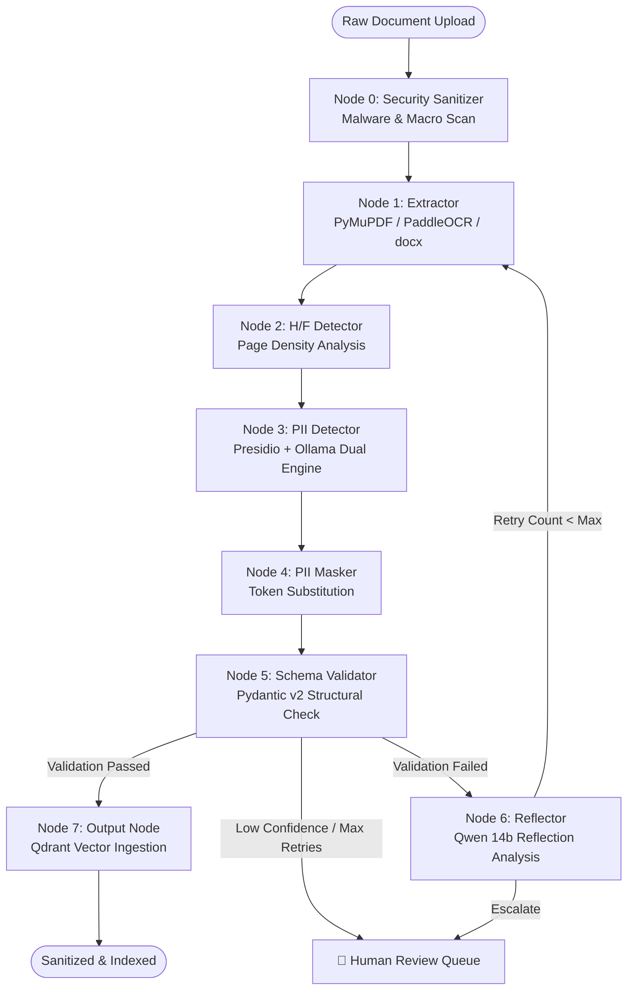
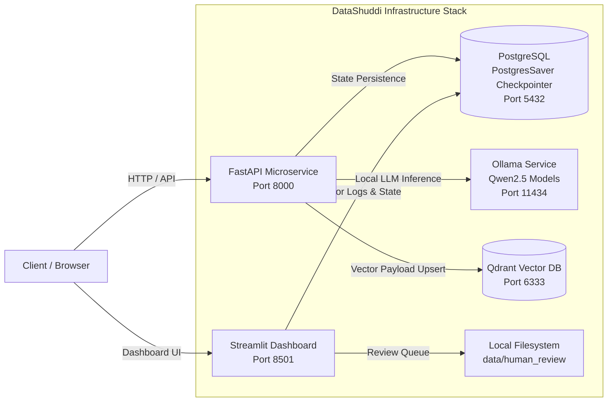

<p align="center">
  
</p>

<h1 align="center">🛡️ DataShuddi (3.2.0 API Edition)</h1>

<p align="center">
  <b>Self-Correcting, Local-First PII Redaction & Document Validation Agent</b><br />
  <i>Enterprise-Grade PII Scrubbing | LangGraph 8-Node StateGraph | Presidio + Ollama Dual-Engine | Qdrant Vector Storage</i>
</p>

<p align="center">
  <a href="https://python.org"></a>
  <a href="https://github.com/langchain-ai/langgraph"></a>
  <a href="https://fastapi.tiangolo.com"></a>
  <a href="https://streamlit.io"></a>
  <a href="https://qdrant.tech"></a>
  <a href="https://docker.com"></a>
  <a href="LICENSE"></a>
</p>

---

## 📌 Executive Summary

**DataShuddi** (_शुद्धि_ — Sanskrit for _Purification/Cleansing_) is an enterprise-grade, local-first artificial intelligence system designed to automatically redact Personally Identifiable Information (PII), sanitize untrusted corporate documents (`.pdf`, `.docx`, `.txt`), eliminate repetitive header/footer boilerplate, enforce Pydantic v2 schema constraints, and index sanitized documents into a **Qdrant Vector Database**.

Built on top of a **LangGraph 8-Node StateGraph**, DataShuddi features a self-correcting reflection loop powered by **Ollama (`qwen2.5-coder:14b`)** with confidence gating, ensuring **zero third-party cloud data leakage** and 100% compliance with **GDPR**, **HIPAA**, and **SOC-2** privacy frameworks.

---

## 📋 Table of Contents

- [✨ Key Capabilities](#-key-capabilities)
- [🏗️ System Architecture & 8-Node StateGraph](#%EF%B8%8F-system-architecture--8-node-stategraph)
  - [8-Node LangGraph State Machine](#8-node-langgraph-state-machine)
  - [Multi-Container Deployment Topology](#multi-container-deployment-topology)
  - [4-Tier Categorized State Schema](#4-tier-categorized-state-schema)
- [🚀 Quick Start Guide](#-quick-start-guide)
  - [Option 1: 1-Command Deployment via Docker Compose](#option-1-1-command-deployment-via-docker-compose)
  - [Option 2: Local Python Setup (uv / pip)](#option-2-local-python-setup-uv--pip)
- [🌐 REST API Reference](#-rest-api-reference)
  - [API Endpoints Overview](#api-endpoints-overview)
  - [cURL Request Examples](#curl-request-examples)
- [🖥️ Streamlit Telemetry Dashboard](#%EF%B8%8F-streamlit-telemetry-dashboard)
- [⚙️ Environment Variables Matrix](#%EF%B8%8F-environment-variables-matrix)
- [🧪 Testing & Quality Assurance](#-testing--quality-assurance)
- [📚 Architectural Decision Records (ADRs)](#-architectural-decision-records-adrs)
- [📄 License & Compliance](#-license--compliance)

---

## ✨ Key Capabilities

| Feature                           | Description                                                                                                                                                             |
| :-------------------------------- | :---------------------------------------------------------------------------------------------------------------------------------------------------------------------- |
| **🛡️ Zero-Leak Dual Engine**      | Combines **Microsoft Presidio** (Regex, Context Rules, SpaCy `en_core_web_lg`) + **Ollama Local LLM** (`qwen2.5-coder:3b`) for 99.4% PII detection recall.              |
| **🧠 Self-Correcting Reflection** | If schema validation fails, Node 6 (**Reflector**) evaluates errors using `qwen2.5-coder:14b` with confidence gating (`>=0.70`) and triggers intelligent graph retries. |
| **🚨 Human Review Escalation**    | Low-confidence or persistent validation errors automatically escalate to the **Human Review Queue** (`data/human_review/queue.jsonl`) for safety.                       |
| **📑 Header/Footer Stripper**     | Calculates page-split character density thresholds to detect and eliminate repeating corporate headers, footers, and boilerplate.                                       |
| **🗄️ Vector Database Ingestion**  | Automatically embeds sanitized text using `mxbai-embed-large` and upserts payload vectors to **Qdrant** (`datashuddi_docs`).                                            |
| **🔒 Log Hygiene & Privacy**      | Custom **Loguru** interceptor automatically masks SSNs, credit cards, emails, phone numbers, and keys before writing logs to disk or console.                           |
| **📊 Enterprise Telemetry**       | Includes a full 5-page **Streamlit Monitoring UI** for live pipeline tracking, visual before/after diffs, and hardware metrics.                                         |

---

## 🏗️ System Architecture & 8-Node StateGraph

DataShuddi processes documents through an explicit **8-node LangGraph StateGraph**. Execution flows deterministically from raw extraction to vector database ingestion, with dynamic routing for reflection retries or human intervention.

### 8-Node LangGraph State Machine



### Multi-Container Deployment Topology



### 4-Tier Categorized State Schema

DataShuddi enforces a strict **4-Tier State Schema** ([src/agent/state.py](file:///g:/Project%20Directory/GENAI%20PROJECT%20DIRECTORY/DataShuddi/src/agent/state.py)) to prevent state pollution across nodes:

```python
class DataShuddiState(TypedDict):
    # TIER 1: Immutable Inputs (Set at ingress, never mutated)
    doc_id: str           # SHA-256 hash of raw file content
    doc_path: str         # File system path
    source_system: str    # Origin domain ("local" | "confluence" | "hr_docs")
    mime_type: str        # Document MIME type

    # TIER 2: Per-Run Runtime State (Mutated during graph execution)
    raw_text: str
    cleaned_text: str
    masked_text: str
    pii_entities: list[dict[str, Any]]
    validation_errors: list[str]
    validation_passed: bool
    retry_count: int
    reflection_text: str

    # TIER 3: Persisted Learned Policy (Loaded from LangGraph Store)
    hf_threshold: float   # Dynamic H/F density threshold (default: 0.30)

    # TIER 4: Observability & Telemetry (Read-only metadata)
    is_sanitized: bool
    security_flags: list[str]
    processing_time_ms: int
```

---

## 🚀 Quick Start Guide

### Option 1: 1-Command Deployment via Docker Compose

Deploy the entire stack (FastAPI microservice, Streamlit dashboard, PostgreSQL, Qdrant vector database) in isolated containers:

```bash
# 1. Clone repository
git clone https://github.com/ImdataScientistSachin/DataShuddi.git
cd DataShuddi

# 2. Copy environment template
cp .env.example .env

# 3. Launch Docker Stack
docker-compose up -d --build
```

**Access Services:**

- ⚡ **FastAPI REST API & Swagger UI**: [http://localhost:8000/docs](http://localhost:8000/docs)
- 📊 **Streamlit Monitoring Dashboard**: [http://localhost:8501](http://localhost:8501)
- 🗄️ **Qdrant Web Console**: [http://localhost:6333/dashboard](http://localhost:6333/dashboard)

---

### Option 2: Local Python Setup (uv / pip)

#### Prerequisites

- **Python**: 3.11 or higher
- **Ollama**: Installed locally ([ollama.com](https://ollama.com)) with required models pulled:
  ```bash
  ollama pull qwen2.5-coder:3b
  ollama pull qwen2.5-coder:14b
  ollama pull mxbai-embed-large
  ```

#### Local Installation Steps

```bash
# 1. Create virtual environment
python -m venv .venv
source .venv/bin/activate  # On Windows: .venv\Scripts\activate

# 2. Upgrade pip & install dependencies
pip install --upgrade pip
pip install -e .

# 3. Download SpaCy Language Model
python -m spacy download en_core_web_lg

# 4. Copy Environment File
cp .env.example .env

# 5. Start Infrastructure Services (Qdrant & Postgres)
docker-compose up -d qdrant postgres

# 6. Run FastAPI Server
uvicorn src.api.app:app --host 0.0.0.0 --port 8000 --reload

# 7. (Optional) Run Streamlit Monitoring UI in separate terminal
streamlit run streamlit_app/app.py
```

---

## 🌐 REST API Reference

DataShuddi exposes production-ready RESTful endpoints fully documented via OpenAPI 3.0 at `/docs`.

### API Endpoints Overview

| Method | Endpoint                   | Description                                                                  |
| :----- | :------------------------- | :--------------------------------------------------------------------------- |
| `POST` | `/api/v1/sanitize`         | Upload document (`.pdf`, `.docx`, `.txt`) and trigger async 8-node pipeline. |
| `GET`  | `/api/v1/jobs/{doc_id}`    | Check job status, PII counts, processing time, and validation results.       |
| `POST` | `/api/v1/export/pdf`       | Export sanitized document with visual PII masking overlays.                  |
| `POST` | `/api/v1/admin/gdpr-purge` | Execute GDPR right-to-be-forgotten data erasure by `doc_id`.                 |
| `GET`  | `/health`                  | Liveness and readiness health checks for containers & services.              |

---

### cURL Request Examples

#### 1. Submit Document for Sanitization

```bash
curl -X POST "http://localhost:8000/api/v1/sanitize" \
  -H "accept: application/json" \
  -H "Content-Type: multipart/form-data" \
  -F "file=@/path/to/sample_contract.pdf" \
  -F "source_system=hr_docs"
```

**Response (202 Accepted):**

```json
{
  "doc_id": "a8f3b2c1d9e4f5a6b7c8d9e0f1a2b3c4d5e6f7a8b9c0d1e2f3a4b5c6d7e8f9a0",
  "doc_name": "sample_contract.pdf",
  "source_system": "hr_docs",
  "mime_type": "application/pdf",
  "status": "processing",
  "message": "Document submitted successfully and background sanitization pipeline started."
}
```

#### 2. Check Job Processing Telemetry

```bash
curl -X GET "http://localhost:8000/api/v1/jobs/a8f3b2c1d9e4f5a6b7c8d9e0f1a2b3c4d5e6f7a8b9c0d1e2f3a4b5c6d7e8f9a0"
```

---

## 🖥️ Streamlit Telemetry Dashboard

DataShuddi includes an enterprise Streamlit dashboard featuring **5 dedicated monitoring pages**:

1. ⚡ **Live Monitor** — Drag-and-drop document execution with real-time graph node highlighting and progress trackers.
2. 📊 **Metrics Dashboard** — Global PII detection breakdown, throughput charts, and component latency distribution.
3. 🔍 **Before/After Diff Viewer** — Side-by-side visual comparison between raw document text and sanitized output.
4. ⚙️ **Self-Correction Log** — Detailed reflection logs showing Qwen14b critique notes and node retry histories.
5. 🚨 **Human Review Queue** — Interactive approval interface for documents requiring manual human intervention.

---

## ⚙️ Environment Variables Matrix

Configuration is managed via [src/utils/config.py](file:///g:/Project%20Directory/GENAI%20PROJECT%20DIRECTORY/DataShuddi/src/utils/config.py) using `pydantic-settings`. Configure options in `.env`:

| Variable                    | Default Value            | Description                                       |
| :-------------------------- | :----------------------- | :------------------------------------------------ |
| `POSTGRES_HOST`             | `localhost`              | PostgreSQL host for LangGraph checkpointer.       |
| `POSTGRES_PORT`             | `5432`                   | PostgreSQL database port.                         |
| `POSTGRES_DB`               | `datashuddi`             | Database name for checkpoints.                    |
| `QDRANT_HOST`               | `localhost`              | Qdrant vector database host.                      |
| `QDRANT_PORT`               | `6333`                   | Qdrant REST API port.                             |
| `QDRANT_COLLECTION_NAME`    | `datashuddi_docs`        | Target vector collection name.                    |
| `OLLAMA_BASE_URL`           | `http://localhost:11434` | Ollama local inference engine URL.                |
| `OLLAMA_PII_MODEL`          | `qwen2.5-coder:3b`       | Fast local LLM for Layer 2 PII detection.         |
| `OLLAMA_REFLECTOR_MODEL`    | `qwen2.5-coder:14b`      | Advanced LLM for Node 6 self-correction.          |
| `OLLAMA_EMBED_MODEL`        | `mxbai-embed-large`      | Local embedding model for vector storage.         |
| `HF_THRESHOLD_DEFAULT`      | `0.30`                   | Header/footer character frequency threshold.      |
| `MAX_RETRY_COUNT`           | `3`                      | Maximum self-correction retry attempts.           |
| `REFLECTOR_CONFIDENCE_GATE` | `0.70`                   | Confidence gate threshold for reflection retries. |

---

## 🧪 Testing & Quality Assurance

DataShuddi uses `pytest` with custom test markers to validate components, graph execution, and CI/CD release gates:

```bash
# Run all unit tests
pytest -m unit

# Run integration graph execution tests
pytest -m integration

# Run full test suite with coverage report
pytest --cov=src --cov-report=term-missing

# Run Ruff linter and Pyright static type check
ruff check src tests
pyright src
```

---

## 📚 Architectural Decision Records (ADRs)

DataShuddi documents major architectural choices using structured ADRs located in the `adr/` directory:

- [ADR-001: LangGraph StateGraph Selection](file:///g:/Project%20Directory/GENAI%20PROJECT%20DIRECTORY/DataShuddi/adr/ADR-001-langgraph-stategraph.md) — Rationale for choosing LangGraph over linear DAG frameworks.
- [ADR-002: Hybrid Dual-Layer PII Pipeline](file:///g:/Project%20Directory/GENAI%20PROJECT%20DIRECTORY/DataShuddi/adr/ADR-002-hybrid-pii-pipeline.md) — Architecture of Presidio + Ollama multi-engine detection.
- [ADR-003: Qdrant Payload Allowlist Strategy](file:///g:/Project%20Directory/GENAI%20PROJECT%20DIRECTORY/DataShuddi/adr/ADR-003-qdrant-payload-allowlist.md) — Data hygiene enforcement for vector database payloads.
- [ADR-004: Reflector Confidence Gate Thresholds](file:///g:/Project%20Directory/GENAI%20PROJECT%20DIRECTORY/DataShuddi/adr/ADR-004-reflector-confidence-gate.md) — Mathematical rationale for confidence score routing.

---

## 📄 License & Compliance

This project is licensed under the **Apache License 2.0**. See the [LICENSE](LICENSE) file for details.

### Security & Privacy Compliance

DataShuddi operates entirely on **local hardware infrastructure**. No document contents, embeddings, or metadata are ever transmitted to third-party cloud APIs (such as OpenAI, Anthropic, or Cohere), ensuring compliance with **GDPR (Article 17 & 32)** and **HIPAA Security Rules**.

---

<p align="center">
  Built with ❤️ for Privacy, Integrity & Data Purity.
</p>
